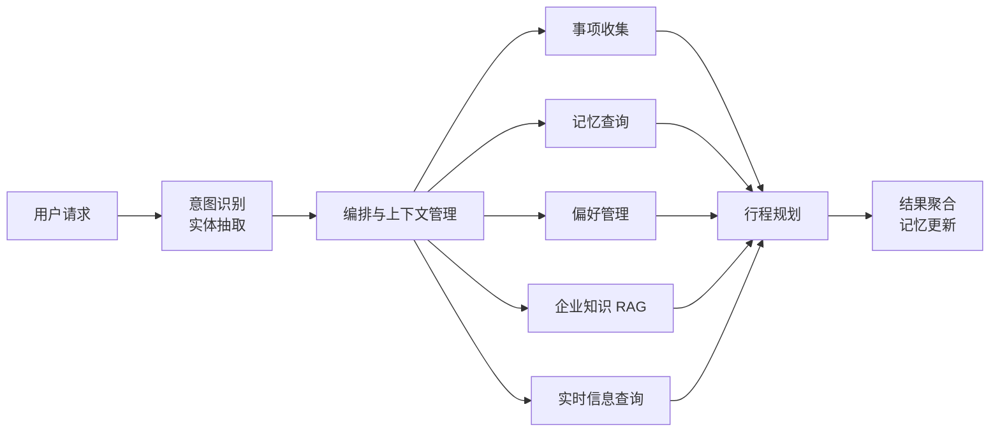

# 企业差旅智能体（Enterprise Travel Agent）

> 一个围绕真实业务流程设计的 Agent 应用：理解差旅需求，查询企业制度与实时信息，记住用户偏好，并组合为可执行的行程建议。

[](https://www.python.org/)
[](https://github.com/modelscope/agentscope)
[](.github/workflows/tests.yml)
[](LICENSE)

## 项目概览

企业差旅不是一次简单问答。一个完整请求通常同时包含日期与城市抽取、差标查询、天气搜索、个人偏好和行程生成。把这些工作全部塞进一个 Prompt，会带来职责混乱、上下文膨胀、错误难定位等问题。

系统将流程拆成 6 个职责单一的 Skill，由意图识别与编排层统一调度：



## 核心实现

| 方向 | 具体实现 | 解决的问题 |
|---|---|---|
| Agent 编排 | 语义意图识别、统一上下文、结果聚合、错误隔离 | 复杂请求可拆解，子任务失败可定位 |
| Skill 插件化 | 元数据发现、注册表、懒加载、统一输入输出约定 | 新增能力不需要修改核心编排流程 |
| 记忆管理 | 会话内短期记忆、JSON 长期记忆、偏好追加与覆盖 | 支持跨轮次理解和个性化规划 |
| 企业知识 RAG | 章节切块、BGE 向量检索、BM25、RRF 融合 | 同时处理语义表达和精确政策关键词 |
| 证据治理 | 来源保留、稳定 ID、去重、字符预算、引用编号 | 控制上下文长度，保留回答依据 |
| 服务可靠性 | 超时、有限重试、指数退避、熔断、健康检查 | 模型服务异常时避免无限等待和故障扩散 |
| 工程保障 | 环境变量隔离、离线测试、GitHub Actions | 密钥不入库，核心规则可持续回归 |

更完整的模块职责、数据流和扩展方式见[架构设计](docs/架构设计.md)。

## 典型使用场景

```text
用户：下周一从北京去杭州出差三天，按公司标准安排，优先我常住的酒店，并提醒天气。

系统处理：
1. 抽取出发地、目的地、日期和差旅时长；
2. 查询住宿与交通标准，并保留政策来源；
3. 读取用户历史酒店偏好；
4. 查询目的地天气；
5. 汇总约束，生成行程与注意事项。
```

系统还支持单独询问“杭州住宿上限是多少”、保存“以后优先选择靠近地铁的酒店”、查询历史行程，以及通过 `health` 命令检查模型服务。

## RAG 方案与验证

RAG 模块不是只完成“接入向量库”，而是覆盖从文档入库到证据装配的完整链路：

```text
企业文档 → 章节感知切块 → 内容哈希与稳定 ID → BGE 编码 → Milvus Lite
                                                        ↓
用户问题 → Dense / BM25 检索 → RRF 融合 → 去重与预算控制 → 带来源的证据
```

离线验证重点检查两个问题：相关政策能否进入 Top-K，以及关键条款能否完整进入模型上下文。结果直接用于当前实现选型：

- 16 道开发题中，Hybrid 的 Hit@3 为 100%，宏平均 Recall@3 为 89.58%；
- 42 道独立留出题用于检查调参后的表现；
- 对照结果支持当前采用章节切块、Top-3 和 CLS 池化；
- Dense 保持默认，Hybrid 作为可选模式，避免用小型样例实验直接替换业务默认。

指标定义、配置决策和未覆盖范围见 [RAG 评估说明](docs/RAG评估.md)。

## 快速开始

推荐使用 Python 3.11 或 3.12。

### 1. 安装依赖

```bash
python -m venv .venv

# Windows PowerShell
.venv\Scripts\Activate.ps1

# macOS / Linux
source .venv/bin/activate

python -m pip install --upgrade pip
pip install -r requirements.txt
```

### 2. 配置模型服务

```bash
# Windows PowerShell
Copy-Item .env.example .env

# macOS / Linux
cp .env.example .env
```

在 `.env` 中填写兼容 OpenAI API 的模型服务：

```dotenv
TRAVEL_LLM_API_KEY=你的密钥
TRAVEL_LLM_MODEL=你的模型名称
TRAVEL_LLM_BASE_URL=https://ark.cn-beijing.volces.com/api/v3
```

`.env` 已被 Git 忽略，真实密钥不会进入仓库。

### 3. 初始化知识库并启动

```bash
python .claude/skills/ask-question/script/init_knowledge_base.py
python cli.py
```

如果本地没有嵌入模型，程序会尝试下载 `BAAI/bge-small-zh-v1.5`。交互中输入 `help` 查看命令，输入 `health` 检查模型服务，输入 `exit` 退出。

## 测试

不调用在线模型的 RAG 回归测试：

```bash
pip install "pytest>=8,<10" "PyYAML>=6,<7"
pytest -q
```

当前验证结果：**16 项全部通过**。测试覆盖切块、稳定 ID、证据去重、预算控制、融合排序、幂等写入、评估集隔离和引用边界。

需要真实 BGE 与 Milvus 的完整评估：

```bash
python scripts/evaluate_rag_engineering.py
python scripts/evaluate_rag_parameters.py
```

## 项目结构

```text
.
├── agents/                 # 意图识别、编排器与 Skill 注册表
├── .claude/skills/         # 六类业务 Skill 及其运行说明
├── context/                # 短期记忆、长期记忆与统一管理器
├── utils/                  # RAG、容错、解析与 Skill 加载工具
├── scripts/                # RAG 数据构建与评估脚本
├── experiments/            # 当前 RAG 协议与评估产物
├── docs/                   # 架构与评估说明
├── tests/                  # 单元、集成与工程回归测试
├── cli.py                  # 命令行入口
└── config.py               # 业务配置与环境变量加载
```

## 当前边界

- 企业制度是演示语料，不代表任何公司的现行政策；
- 长期记忆使用本地 JSON，适合单机原型，不适合直接用于多用户生产环境；
- 引用校验只能确认引用编号存在，尚未验证生成结论是否被证据完整支持；
- 最近邻检索总会返回结果，当前版本没有把相似度阈值包装成可靠的无答案判断；
- CLI 展示了核心链路，Web 界面、鉴权、审计日志和在线监控仍属于后续工程。

## 可继续演进

- 引入真实用户问题和独立人工标注，完善端到端效果评估；
- 增加逐句事实一致性检查和可靠拒答机制；
- 将本地记忆迁移到支持并发用户的持久化存储；
- 增加 Web 演示界面、链路追踪和成本监控。

## 许可证

本项目采用 [MIT License](LICENSE)。
