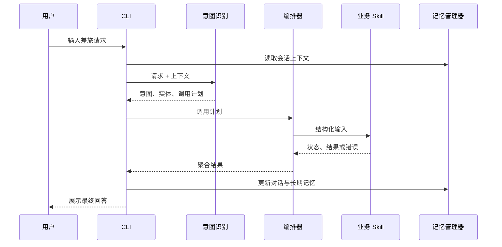

# 架构设计

## 1. 设计目标

企业差旅智能体面向包含多类信息源的复杂差旅请求。系统设计围绕四个目标：

1. 将意图识别、数据访问、知识检索和内容生成拆成清晰职责；
2. 让每个业务能力可以独立测试、替换和扩展；
3. 在模型或网络服务失败时返回可诊断结果，而不是静默生成；
4. 保留政策来源和执行上下文，便于检查回答依据。

当前实现是单机原型，优先验证 Agent 工作流，不提前引入微服务、消息队列或复杂基础设施。

## 2. 分层结构

| 层 | 模块 | 职责 |
|---|---|---|
| 交互层 | `cli.py` | 接收输入、展示结果、提供帮助和健康检查 |
| 理解层 | `agents/intention_agent.py` | 识别意图、抽取实体、生成调用计划 |
| 编排层 | `agents/orchestration_agent.py` | 组织上下文、调用 Skill、隔离错误、聚合结果 |
| 注册层 | `agents/lazy_agent_registry.py` | 扫描 Skill 元数据并按需实例化 |
| 能力层 | `.claude/skills/*` | 执行知识问答、信息查询、记忆和行程规划 |
| 状态层 | `context/*` | 管理会话上下文、长期记忆和更新时机 |
| 基础能力 | `utils/*` | 检索、重试、熔断、JSON 解析与兼容处理 |

## 3. 一次请求的生命周期

编排器不会假设所有 Skill 都成功。单个能力加载失败、调用超时或返回格式异常时，会记录对应错误并继续处理仍然可用的结果。

## 4. Skill 边界

每个 Skill 都包含三类信息：

- 使用条件：什么意图下应该调用；
- 输入输出：需要哪些字段，返回什么结构；
- 执行约束：缺少信息、无结果和失败如何表达。

注册表只在 Skill 首次使用时导入实现。这样既减少无关初始化，也让新增能力主要发生在插件目录中，而不是不断扩大编排器。

## 5. 记忆设计

系统区分两种状态：

- 短期记忆保存当前会话消息，用于理解省略表达和连续追问；
- 长期记忆以用户为单位保存偏好、历史行程和摘要，用于跨会话个性化。

偏好更新显式区分“追加”和“覆盖”。例如“我也喜欢全季”应追加品牌，“以后只住全季”则应覆盖原值。当前 JSON 存储便于原型验证，但不承担多进程并发、一致性事务或权限隔离。

## 6. RAG 数据流

### 入库

1. 按标题、章节和自然段切分制度文档；
2. 保存来源、章节、块序号与内容哈希；
3. 使用稳定整数 ID，重复内容通过 upsert 保持幂等；
4. 使用 BGE 生成归一化向量并写入 Milvus Lite；
5. 同步保存同源语料清单，供 BM25 检索使用。

### 查询

1. 对问题进行向量编码；
2. 按配置执行 Dense，或同时执行 Dense 与 BM25；
3. Hybrid 模式使用 RRF 合并两路排名；
4. 对证据正文去重，并在字符预算内保留完整片段；
5. 给证据分配引用编号，将来源与正文一起交给生成模型。

评估方法和参数选择见 [RAG 评估说明](RAG评估.md)。

## 7. 可靠性设计

- 请求设置明确超时，避免外部调用永久占用会话；
- 只对可恢复错误执行有限次数重试，并使用指数退避；
- 连续失败达到阈值后打开熔断器，恢复窗口后再进行探测；
- `python cli.py health` 可独立检查模型服务；
- JSON 解析器处理模型输出中的代码块和非标准包裹，无法恢复时返回明确错误。

这些机制提高的是故障可控性，不保证外部模型一定成功。

## 8. 扩展方式

新增业务能力时，优先新建一个职责单一的 Skill，并定义结构化契约。只有当多个 Skill 出现稳定的重复逻辑时，才将其下沉到公共模块。具体约定见 [Skill 开发说明](../.claude/skills/README.md)。

## 9. 当前边界

- 当前是 CLI 单机应用，没有鉴权、租户隔离和在线审计；
- JSON 长期记忆不适用于多实例部署；
- 企业制度为样例数据，没有政策版本管理和审批流程；
- 编排质量尚未使用真实业务请求进行独立人工评测；
- 引用存在不等于语义支持，生成答案仍需事实一致性检查。
